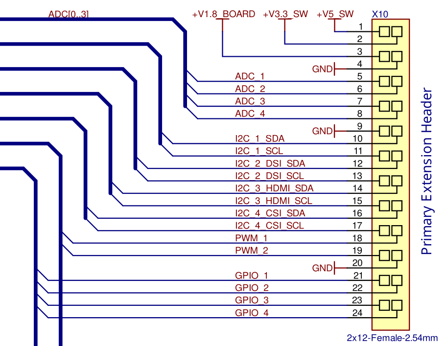
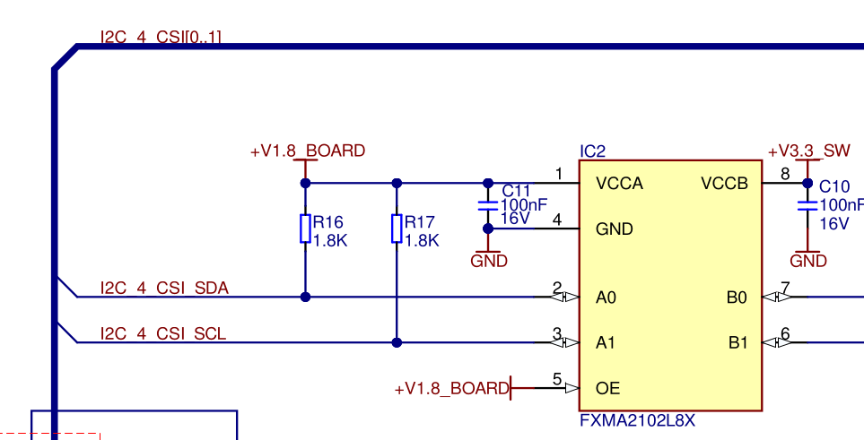

# 2026-11-15a wrong pins

I observe:

* [Datasheet](downloads/mallow_carrier_board_v1.1_datasheet_rev1.10.pdf]
SODIMM_93 is documented ad pinX10-17
* I run `gpioset --toggle=1000 SODIMM_93=1`
Now pinX10-16 toggles and not X10-17 as documeted.

## Links

* https://community.toradex.com/t/swapped-i2c-pins-in-documentation/29151


### How to read the device tree:

```bash
dtc -I dtb -O dts /boot/ostree/torizon-6e27bd660a7ed27a0450d2a020fd244f1b2d037fe6f2d8cec0ea9eccf812ca9c/dtb/imx8mp-verdin-nonwifi-mallow.dtb 2>/dev/null | grep -B 20 "SODIMM_95.*SODIMM_93" | head -50
```

```text
gpio@30240000 {
    compatible = "fsl,imx8mp-gpio\0fsl,imx35-gpio";
    reg = <0x30240000 0x10000>;
    interrupts = <0x00 0x48 0x04 0x00 0x49 0x04>;
    clocks = <0x02 0xc5>;
    gpio-controller;
    #gpio-cells = <0x02>;
    interrupt-controller;
    #interrupt-cells = <0x02>;
    gpio-ranges = <0x15 0x00 0x72 0x1e>;
    gpio-line-names = "SODIMM_42\0SODIMM_46\0SODIMM_187\0SODIMM_20\0SODIMM_22\0SODIMM_15\0SODIMM_196\0SODIMM_200\0SODIMM_198\0SODIMM_202\0SODIMM_164\0SODIMM_152\0SODIMM_116\0SODIMM_128\0\0\0SODIMM_55\0SODIMM_53\0SODIMM_95\0SODIMM_93\0SODIMM_14\0SODIMM_12\0SODIMM_129\0SODIMM_131\0SODIMM_137\0SODIMM_139\0SODIMM_147\0SODIMM_149\0SODIMM_151\0SODIMM_153";
};

Line 0: SODIMM_42
Line 1: SODIMM_46
Line 2: SODIMM_187
Line 3: SODIMM_20
Line 4: SODIMM_22
Line 5: SODIMM_15
Line 6: SODIMM_196
Line 7: SODIMM_200
Line 8: SODIMM_198
Line 9: SODIMM_202
Line 10: SODIMM_164
Line 11: SODIMM_152
Line 12: SODIMM_116
Line 13: SODIMM_128
Line 14: 
Line 15: 
Line 16: SODIMM_55
Line 17: SODIMM_53
Line 18: SODIMM_95
Line 19: SODIMM_93
Line 20: SODIMM_14
Line 21: SODIMM_12
Line 22: SODIMM_129
Line 23: SODIMM_131
Line 24: SODIMM_137
Line 25: SODIMM_139
Line 26: SODIMM_147
Line 27: SODIMM_149
Line 28: SODIMM_151
Line 29: SODIMM_153
Line 30: 
Line 31: 
```

So the kernel device tree definitively has SODIMM_93 mapped to line 19 of gpiochip4, which controls physical pin X10-16 on the connector. The datasheet's claim that SODIMM_93 = pinX10-17 is the error.

## Claude about the kernel sources

* I2C3 Controller Definition (imx8mp-verdin.dtsi:681-690)

```
/* Verdin I2C_4_CSI */
&i2c3 {
    clock-frequency = <400000>;
    pinctrl-names = "default", "gpio";
    pinctrl-0 = <&pinctrl_i2c3>;
    pinctrl-1 = <&pinctrl_i2c3_gpio>;
    scl-gpios = <&gpio5 18 (GPIO_ACTIVE_HIGH | GPIO_OPEN_DRAIN)>;
    sda-gpios = <&gpio5 19 (GPIO_ACTIVE_HIGH | GPIO_OPEN_DRAIN)>;
    single-master;
};
```

* Pin Control Definitions (imx8mp-verdin.dtsi:1179-1190)

```
/* Verdin I2C_4_CSI */
pinctrl_i2c3: i2c3grp {
    fsl,pins =
        <MX8MP_IOMUXC_I2C3_SCL__I2C3_SCL		0x400001c6>,	/* SODIMM 95 */
        <MX8MP_IOMUXC_I2C3_SDA__I2C3_SDA		0x400001c6>;	/* SODIMM 93 */
};

pinctrl_i2c3_gpio: i2c3gpiogrp {
    fsl,pins =
        <MX8MP_IOMUXC_I2C3_SCL__GPIO5_IO18		0x400001c6>,	/* SODIMM 95 */
        <MX8MP_IOMUXC_I2C3_SDA__GPIO5_IO19		0x400001c6>;	/* SODIMM 93 */
};
```

**Summary**
* SODIMM_93 = I2C3_SDA (Serial Data) mapped to GPIO5_IO19
* SODIMM_95 = I2C3_SCL (Serial Clock) mapped to GPIO5_IO18
  When used as GPIO (via the gpio pinctrl state), they can be controlled individually with gpioset SODIMM_93=... or gpioset SODIMM_95=...

This aligns with your observation that the pinctrl mappings appear to have the pins reversed compared to the Mallow carrier board datasheet documentation.

**Summary Hans**

| Datasheet Signal | Datasheet SODIMM | imx8mp-verdin.dtsi i2c | imx8mp-verdin.dtsi i2c3grp i2c3gpiogrp | imx8mp-verdin.dtsi  | 
| - | - | - | - | - |
| I2C_4_CSI_SCL | 95 | scl: gpio5 18 | MX8MP_IOMUXC_I2C3_SCL__I2C3_SCL | MX8MP_IOMUXC_I2C3_SCL__GPIO5_IO18 | |
| I2C_4_CSI_SDA | 93 | sda: gpio5 19 | MX8MP_IOMUXC_I2C3_SDA__I2C3_SDA | MX8MP_IOMUXC_I2C3_SDA__GPIO5_IO19 | |


## Looking at the schematics

doc_obsolete/README_2026-11-15a_wrong_pins_schematics/header_x10.png

| X10 | schematics | pdf | outcome |
| - | - | - | - |
| X10-10 | I2C_1_SDA | I2C_1_SDA | ok |
| X10-11 | I2C_1_SCL | I2C_1_SCL | ok |
| X10-12 | I2C_2_DSI_SDA | I2C_2_DSI_SDA | ok |
| X10-13 | I2C_2_DSI_SCL | I2C_2_DSI_SCL | ok |
| X10-14 | I2C_3_HDMI_SDA | I2C_3_HDMI_SDA | ok |
| X10-15 | I2C_3_HDMI_SCL | I2C_3_HDMI_SCL | ok |
| X10-16 | I2C_4_CSI_SDA | I2C_4_CSI_SCL | swapped |
| X10-17 | I2C_4_CSI_SCL | I2C_4_CSI_SDA | swapped |





ATTENTION: IC2 may drive these pins
